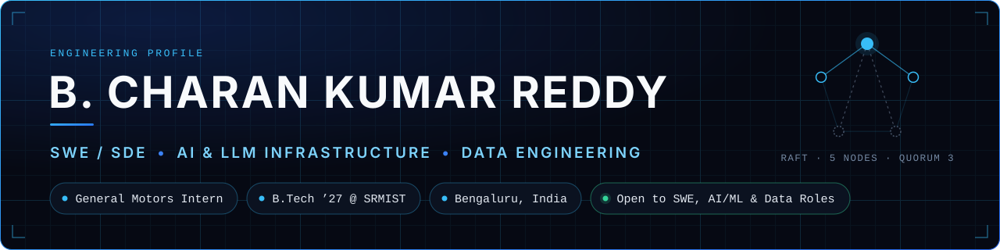

  

  <a href="https://charan-reddy-dev.github.io/portfolio/"><b>Portfolio</b></a>&nbsp;&nbsp;·&nbsp;&nbsp;<a href="https://www.linkedin.com/in/b-charan-kumar-reddy/"><b>LinkedIn</b></a>&nbsp;&nbsp;·&nbsp;&nbsp;<a href="https://leetcode.com/u/charan_red"><b>LeetCode</b></a>&nbsp;&nbsp;·&nbsp;&nbsp;<a href="mailto:charan.workmaill@gmail.com"><b>charan.workmaill@gmail.com</b></a>

Final-year B.Tech student (graduating May 2027) and **Student Intern (AI/ML & Data Automation) at General Motors Technical Center India**, Bengaluru.
I build low-latency LLM inference systems, fault-tolerant distributed backends and streaming CDC lakehouses.

### Selected production & benchmark highlights

| Work | Outcome | Evidence |
|---|---|---|
| **General Motors** AI/ML & Data Automation | Automated die-face creation for hood, fender, roof and door panels: **18 hours → 5 minutes per panel**. Built a CAD surface-quality validation tool (Python, NX Open) adopted by 7 engineers, saving **~47 hours/month** of manual review. | Internship outcome; internal tool, not public |
| **LLM inference** Labmentix | Inference latency cut **36% (2.5 s → 1.6 s)** with INT8 quantization and prompt caching; an LLM-powered log-analysis service (FastAPI) sped up root-cause triage by **60%**. | Internship outcome; internal, not public |
| **[LakeFlow](https://github.com/charan-reddy-dev/lakeflow)** Streaming CDC lakehouse | Debezium → Kafka → Spark Structured Streaming (**5 s micro-batches**) → Apache Iceberg, with LSN-guarded idempotent `MERGE` deduplication. A fault-injection test kills Spark between the Iceberg commit and the offset commit; the replay writes **zero duplicate rows**. | [`test_data_plane.py`](https://github.com/charan-reddy-dev/lakeflow/blob/main/tests/integration/test_data_plane.py), runs in CI |
| **[FeatureHub + DataGuard](https://github.com/charan-reddy-dev/featurehub-dataguard)** ML feature store & data quality | **25 versioned YAML data contracts** and Great Expectations gates across **26 Airflow-orchestrated pipeline definitions**; Redis feature lookups at **1.62 ms p99**; **~355k rows/s** validation throughput. | [`final_results.json`](https://github.com/charan-reddy-dev/featurehub-dataguard/blob/main/featurehub/benchmarks/final_results.json), [`final_quality_results.json`](https://github.com/charan-reddy-dev/featurehub-dataguard/blob/main/dataguard/benchmarks/final_quality_results.json) |
| **[RaftKV](https://github.com/charan-reddy-dev/raftkv)** Distributed consensus | 5-node Raft key-value store (asyncio, gRPC) with leader election and a replicated state-machine log; keeps committing writes with **2 of 5 nodes down**. | [`test_fault_injection.py`](https://github.com/charan-reddy-dev/raftkv/blob/main/tests/test_fault_injection.py), runs in CI |

Repository figures link to the committed benchmark file or CI test behind them and were measured on one machine with synthetic data, as each repository's README states. General Motors and Labmentix figures are internship outcomes from internal tools.

### Core engineering matrix

| SWE & distributed systems | AI, agents & machine learning | Data engineering & cloud |
|---|---|---|
| Python · C++ · Java · TypeScript | Multi-agent DAGs (PEVR) · RAG pipelines | SQL · PySpark · Apache Spark (Streaming) |
| Raft consensus · gRPC · Redis (ZSETs / Lua) | INT8 quantization · prompt caching | Apache Kafka · Apache Iceberg · Trino · Debezium CDC |
| REST APIs · FastAPI | FAISS · Pinecone | Airflow · Great Expectations · OpenLineage |
| Docker · Linux · GitHub Actions CI/CD | PyTorch · scikit-learn · XGBoost · SHAP | AWS · Microsoft Azure · GCP |

### Certifications

| Cloud | Data & AI |
|---|---|
| AWS Certified Developer – Associate | Databricks Certified Data Engineer Associate |
| Microsoft Azure Developer Associate (AZ-204) | IBM Data Engineering Professional Certificate |
| Google Cloud Associate Cloud Engineer | IIT Madras Data Science Certification |
